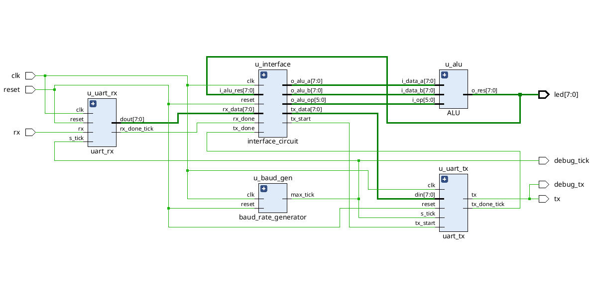
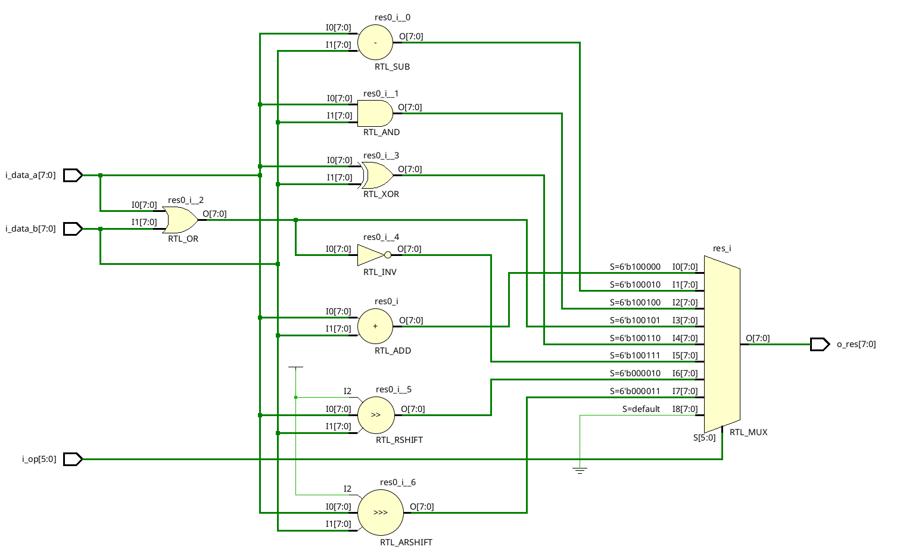
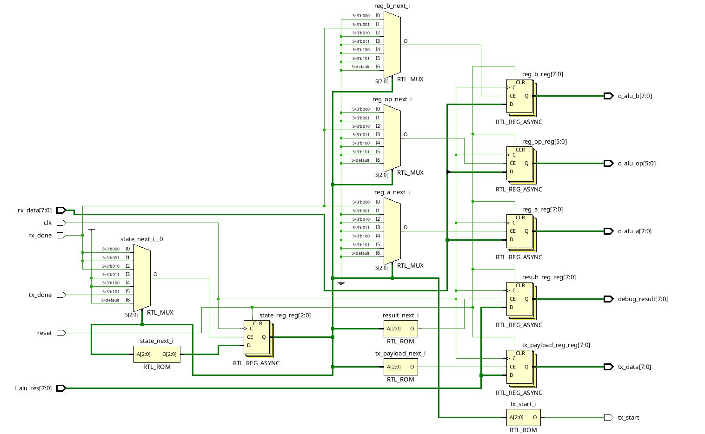
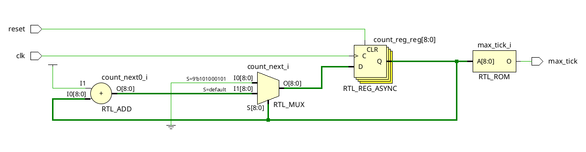
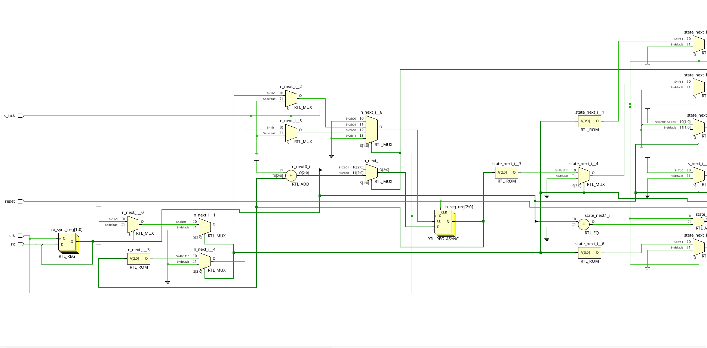
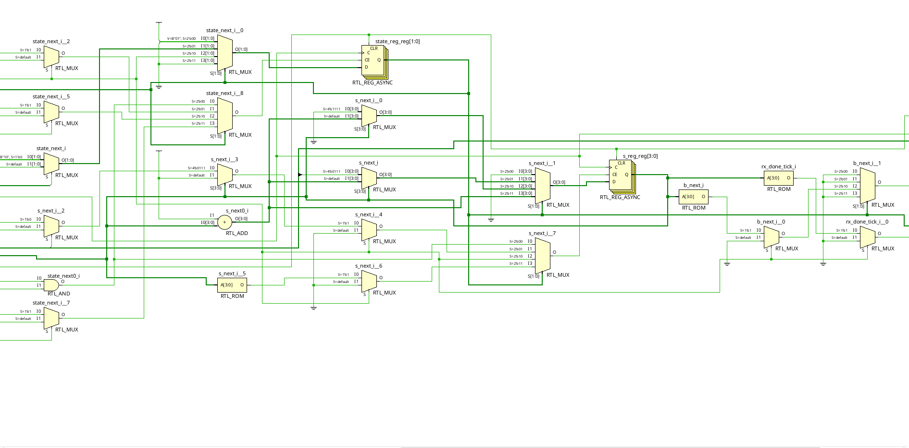
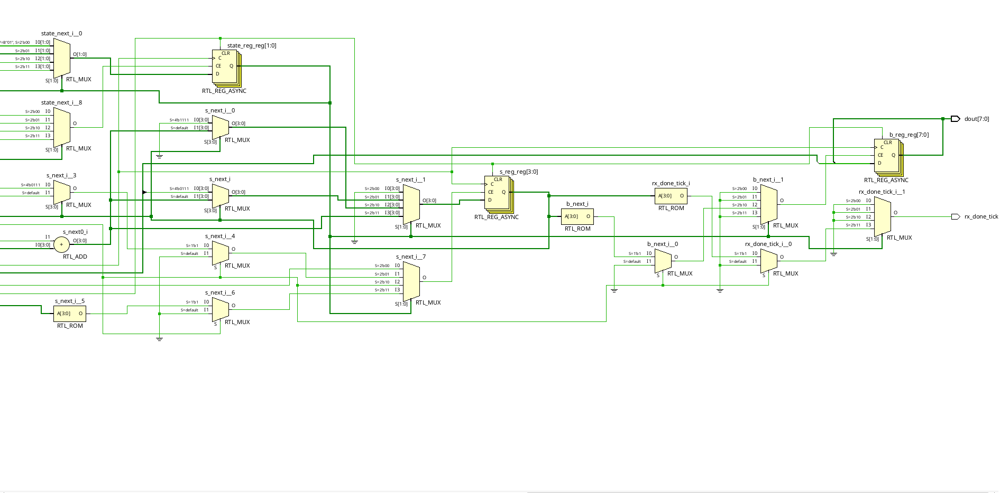
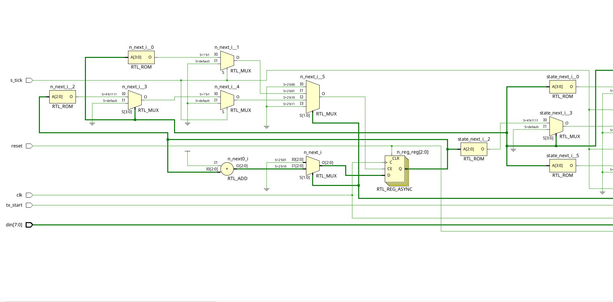
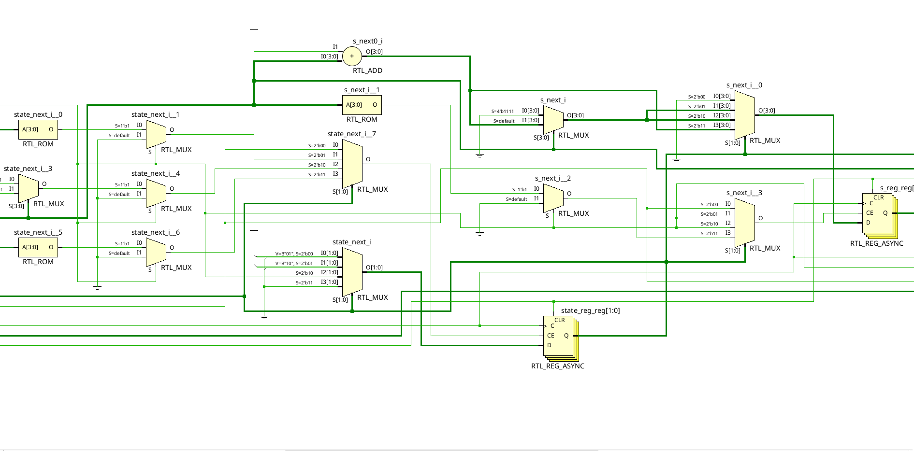
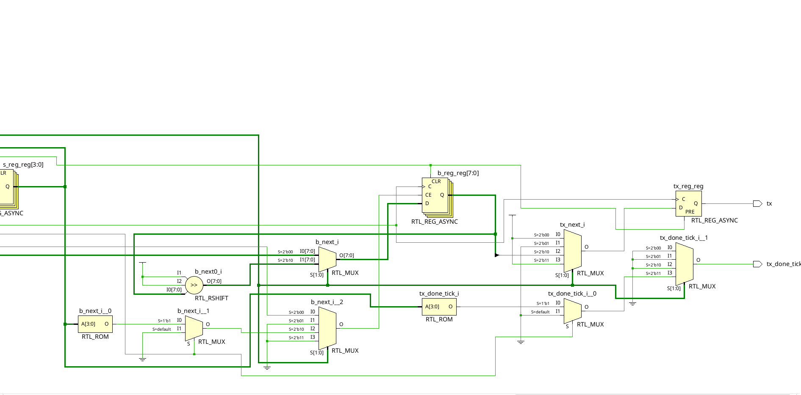

# TP2 - UART | Arquitectura de Computadoras

## Integrantes

- Benjamin Brezzo
- Dario Castillo

Materia: **Arquitectura de Computadoras**  
Trabajo práctico: **TP2 - UART**

Este trabajo práctico implementa una comunicación UART entre una computadora y
una placa FPGA Basys 3. La comunicación permite enviar dos operandos y un
código de operación a la placa, ejecutar una operación de la ALU y recibir el
resultado por el mismo enlace serie.

El proyecto utiliza como base la ALU desarrollada en el TP1:
[ALU-ArqComp](https://github.com/benjabrezzo/ALU-ArqComp).

## Descripción general

El sistema completo está compuesto por:

1. Una interfaz UART para recibir datos desde la PC.
2. Una máquina de estados que arma una transacción a partir de tres bytes:
   operando `A`, operando `B` y código de operación.
3. La ALU del TP1, que procesa los operandos.
4. Una interfaz UART para transmitir el resultado de 8 bits a la PC.
5. Ocho LEDs de la Basys 3 que muestran el último resultado calculado.

La configuración serie utilizada es:

- Velocidad: `19200 baudios`.
- Datos: `8 bits`.
- Bit de inicio: `1`.
- Bit de parada: `1`.
- Sin paridad.

### Códigos de operación

| Operación | Opcode |
|---|---:|
| ADD | `0x20` |
| SUB | `0x22` |
| AND | `0x24` |
| OR | `0x25` |
| XOR | `0x26` |
| NOR | `0x27` |
| SRL - desplazamiento lógico a la derecha | `0x02` |
| SRA - desplazamiento aritmético a la derecha | `0x03` |

Las operaciones trabajan con datos de 8 bits. Si se recibe un opcode no
válido, la ALU devuelve `0x00`.

## Cómo utilizar el proyecto

### 1. Abrir y programar la placa

1. Abrir `project_2.xpr` con **Xilinx Vivado**.
2. Verificar que la placa seleccionada sea una **Basys 3** con dispositivo
   `xc7a35tcpg236-1`.
3. Ejecutar la síntesis, implementación y generación del bitstream.
4. Programar la FPGA mediante el cable USB de la Basys 3.
5. Conectar la placa a la computadora y verificar que el puerto serie USB
   haya sido detectado.

El botón central de la Basys 3 funciona como reset activo en alto. Al iniciar
una nueva prueba, se recomienda presionarlo una vez para llevar el sistema a
su estado inicial.

### 2. Usar el programa Python

El archivo [`uart_terminal.py`](./uart_terminal.py) realiza la conexión entre
el puerto USB de la computadora y la UART implementada en la placa. El
programa configura el puerto a 19200 baudios, transmite los tres bytes de la
operación y espera un byte de respuesta.

En Linux, se puede ejecutar de forma interactiva:

```bash
python3 uart_terminal.py
```

El programa solicitará:

```text
A (ej. 5 o 0x05):
B (ej. 3 o 0x03):
Opcode (ej. 0x20):
```

También se pueden pasar los valores como argumentos:

```bash
python3 uart_terminal.py --a 5 --b 3 --opcode 0x20
```

El resultado esperado para ese ejemplo es:

```text
Enviado: 05 03 20
Recibido: 08 (8)
```

Si la detección automática del puerto no funciona, se puede indicar
manualmente:

```bash
python3 uart_terminal.py --port /dev/ttyUSB2 --a 5 --b 3 --opcode 0x20
```

El script busca primero el dispositivo Digilent en
`/dev/serial/by-id/` y, si no lo encuentra, utiliza el único dispositivo
disponible con nombre `/dev/ttyUSB*`. Si hay más de un puerto posible, se
debe usar la opción `--port`.

El archivo Python utiliza `termios`, por lo que está pensado para ejecutarse
en Linux o macOS. El usuario debe tener permisos para acceder al puerto serie
de la placa.

## Implementación del TP2

La implementación HDL se encuentra dentro de
[`project_2.srcs`](./project_2.srcs), que es la carpeta de fuentes del
proyecto de Vivado.

### Módulo superior: `top_uart_alu`

[`top_ALU.v`](./project_2.srcs/sources_1/new/top_ALU.v) integra todos los
bloques del sistema:

- Generador de pulsos de baud rate.
- Receptor UART.
- Transmisor UART.
- Circuito de interfaz y máquina de estados.
- ALU del TP1.

El reloj de la Basys 3 es de 100 MHz. El módulo genera un tick de
sobremuestreo para UART utilizando 16 ticks por bit y una velocidad de
19200 baudios. La salida serie permanece en nivel alto cuando está inactiva.

### ALU del TP1

[`ALU.v`](./project_2.srcs/sources_1/new/ALU.v) implementa las ocho
operaciones indicadas en la tabla de opcodes. Sus entradas son dos datos de
8 bits y un código de operación de 6 bits. La salida es un resultado de 8
bits y la lógica es combinacional.

La operación `SRA` conserva el bit de signo mediante un desplazamiento
aritmético, mientras que `SRL` introduce ceros mediante un desplazamiento
lógico.

### Receptor UART

[`uart_rx.v`](./project_2.srcs/sources_1/new/uart_rx.v) recibe cada trama
serie mediante una máquina de estados con las fases:

- `IDLE`: espera la detección del bit de inicio.
- `START`: valida el bit de inicio en el centro del tiempo de bit.
- `DATA`: muestrea los 8 bits de datos, del LSB al MSB.
- `STOP`: espera y valida el bit de parada.

La entrada `rx` se sincroniza con dos flip-flops antes de ser utilizada por la
máquina de estados, reduciendo el riesgo de metastabilidad.

### Transmisor UART

[`uart_tx.v`](./project_2.srcs/sources_1/new/uart_tx.v) transmite un byte con
el formato UART 8N1. Sus estados son:

- `IDLE`: línea en reposo.
- `START`: transmite el bit de inicio en cero.
- `DATA`: transmite los 8 bits comenzando por el LSB.
- `STOP`: transmite el bit de parada en uno.

Al finalizar la transmisión genera el pulso `tx_done_tick`, que permite al
circuito de interfaz comenzar una nueva transacción.

### Generador de baud rate

[`baud_rate_generator.v`](./project_2.srcs/sources_1/new/baud_rate_generator.v)
divide el reloj de 100 MHz para generar el tick de sincronización utilizado
por el receptor y el transmisor. El diseño utiliza un pulso de habilitación
en lugar de crear un segundo reloj.

### Circuito de interfaz y máquina de estados

[`interface_circuit.v`](./project_2.srcs/sources_1/new/interface_circuit.v)
coordina la recepción de los operandos, la ejecución de la ALU y la
transmisión del resultado. La secuencia de estados es:

1. `WAIT_A`: espera el primer byte y lo guarda como operando `A`.
2. `WAIT_B`: espera el segundo byte y lo guarda como operando `B`.
3. `WAIT_OP`: espera el opcode.
4. `CALC_SEND`: captura el resultado de la ALU.
5. `SEND`: inicia la transmisión del resultado.
6. `WAIT_TX`: espera que termine la transmisión y vuelve a `WAIT_A`.

Por lo tanto, cada transacción tiene el siguiente formato:

```text
PC -> FPGA:  [A] [B] [OPCODE]
FPGA -> PC:  [RESULTADO]
```

### Antirrebote

[`debouncer.v`](./project_2.srcs/sources_1/new/debouncer.v) contiene un
antirrebote para botones físicos. El diseño principal utiliza el botón
central como reset y el archivo queda disponible como módulo auxiliar para
entradas de usuario.

### Restricciones de pines

Las asignaciones de reloj, reset, UART, LEDs y salidas de depuración se
encuentran en [`basys3.xdc`](./project_2.srcs/constrs_1/new/basys3.xdc):

- `clk`: reloj de 100 MHz de la Basys 3.
- `reset`: botón central.
- `rx` y `tx`: interfaz USB-UART de la placa.
- `led[7:0]`: resultado de la ALU.
- `debug_tx` y `debug_tick`: señales de prueba disponibles en el conector
  PMOD JA para observación con osciloscopio.

## Diagramas RTL del diseño

La carpeta [`img`](./img) contiene los diagramas RTL generados por Vivado.
Estos diagramas permiten observar cómo se sintetiza cada módulo y cómo se
conectan los registros, multiplexores, contadores y bloques combinacionales.

### Integración completa del sistema

El diagrama del módulo superior muestra la conexión entre los bloques
principales del TP2:



El flujo de datos es el siguiente:

1. `rx` recibe los bits provenientes de la PC.
2. `u_uart_rx` reconstruye cada byte y genera `rx_done_tick`.
3. `u_interface` recibe los bytes en el orden `A`, `B` y `OPCODE`.
4. `u_alu` calcula el resultado.
5. `u_interface` entrega el resultado a `u_uart_tx`.
6. `u_uart_tx` transmite el byte por `tx`.
7. El resultado también se conecta a `led[7:0]`.

El mismo diagrama muestra que el `baud_rate_generator` entrega el tick común
de sobremuestreo a los módulos UART. Las salidas `debug_tx` y `debug_tick`
permiten observar el funcionamiento interno mediante el conector PMOD.

### Unidad aritmético-lógica

El diagrama de la ALU muestra las ocho rutas de cálculo y el multiplexor que
selecciona la salida según `i_op`:



Las rutas implementadas son:

- Suma y resta.
- AND, OR, XOR y NOR bit a bit.
- Desplazamiento lógico a la derecha (`SRL`).
- Desplazamiento aritmético a la derecha (`SRA`).

El multiplexor final recibe todas las salidas y selecciona una de ellas
según el opcode. Para cualquier código no contemplado se selecciona la
salida por defecto, que es cero.

### Circuito de interfaz

El circuito de interfaz contiene los registros que almacenan los operandos,
el opcode y el resultado. También contiene la lógica de transición de la
máquina de estados:



En el diagrama se pueden identificar:

- `reg_a_reg`: registro del primer operando.
- `reg_b_reg`: registro del segundo operando.
- `reg_op_reg`: registro del código de operación.
- `result_reg`: registro del resultado calculado.
- `tx_payload_reg`: registro del byte que se enviará.
- `state_reg`: registro de estado de la transacción.

Cuando `rx_done` indica que llegó un byte válido, la lógica selecciona el
registro correspondiente. Luego de recibir el opcode, la interfaz captura
`i_alu_res`, carga el dato de transmisión y genera `tx_start`. Al recibir
`tx_done`, vuelve al estado `WAIT_A` para aceptar una nueva operación.

### Generador de baud rate

El generador divide el reloj de 100 MHz mediante un contador. Cuando el
contador alcanza el valor máximo, vuelve a cero y genera un pulso
`max_tick`:



Con los parámetros del proyecto, el divisor se calcula para obtener 16
ticks por bit a 19200 baudios. Este pulso no es un reloj adicional: funciona
como habilitación para que los bloques `uart_rx` y `uart_tx` avancen.

### Receptor UART

El receptor UART está implementado como una máquina de estados. Debido a que
el diagrama sintetizado es extenso, se incluyen tres vistas parciales:







Las vistas muestran:

- El sincronizador de dos flip-flops para la entrada `rx`.
- El registro de estado `state_reg`.
- El contador de ticks `s_reg`, que ubica el centro de cada bit.
- El contador de bits `n_reg`.
- El registro de desplazamiento `b_reg`, que reconstruye el byte.
- La generación del pulso `rx_done_tick`.

La secuencia RTL corresponde a los estados `IDLE`, `START`, `DATA` y
`STOP` descritos anteriormente.

### Transmisor UART

El transmisor utiliza una estructura equivalente, pero desplaza el dato hacia
la salida serial:







En estas vistas se observan:

- El registro de estado del transmisor.
- El contador de ticks de cada bit.
- El contador de bits transmitidos.
- El registro `b_reg`, que desplaza el dato hacia la derecha.
- `tx_reg`, que mantiene el nivel de la línea `tx`.
- La señal `tx_done_tick`, generada al finalizar el bit de parada.

La salida permanece en uno cuando está inactiva, baja durante el bit de
inicio, transmite los ocho bits de datos desde el LSB y vuelve a uno durante
el bit de parada.

## Simulación y verificación

El proyecto incluye dos bancos de prueba en
[`project_2.srcs/sim_1/new`](./project_2.srcs/sim_1/new):

- [`tb_ALU.v`](./project_2.srcs/sim_1/new/tb_ALU.v): verifica la ALU con
  casos de borde, 2000 vectores aleatorios para opcodes válidos y 200
  vectores con opcodes arbitrarios.
- [`tb_top_uart_alu.v`](./project_2.srcs/sim_1/new/tb_top_uart_alu.v):
  simula la comunicación completa UART-FPGA para las ocho operaciones de la
  ALU, además de un opcode inválido.

Para ejecutar las simulaciones, abrir el proyecto en Vivado, seleccionar el
testbench correspondiente y ejecutar **Run Simulation**. La simulación del
top-level modela el envío de bytes desde la PC, captura la respuesta de la
FPGA y marca las pruebas como `PASS` o `FAIL`.

### Evidencia de simulación

El archivo [`simulacion-log.txt`](./simulacion-log.txt) contiene la salida
completa registrada durante la ejecución de `tb_top_uart_alu` en XSim. El log
documenta las etapas de compilación, elaboración y simulación, además de los
bytes enviados, los bytes recibidos y los resultados de cada operación.

La ejecución final verifica nueve transacciones UART completas:

| Prueba | Datos enviados | Resultado recibido | Estado |
|---|---|---|---|
| ADD | `05 03 20` | `08` | PASS |
| SUB | `0F 06 22` | `09` | PASS |
| AND | `F0 0F 24` | `00` | PASS |
| OR | `F0 0F 25` | `FF` | PASS |
| XOR | `F0 0F 26` | `FF` | PASS |
| NOR | `F0 0F 27` | `00` | PASS |
| SRL | `80 02 02` | `20` | PASS |
| SRA | `80 02 03` | `E0` | PASS |
| Opcode inválido | `AA 55 00` | `00` | PASS |

Cada operación sigue el protocolo:

```text
PC/Testbench -> FPGA:  [A] [B] [OPCODE]
FPGA -> PC/Testbench:  [RESULTADO]
```

Algunos fragmentos representativos del log son:

```text
--- PRUEBA UART: A=0x05 B=0x03 OPCODE=0x20 ---
[RESULTADO]: PASS! (Se recibio 0x08)

--- PRUEBA UART: A=0x80 B=0x02 OPCODE=0x03 ---
[RESULTADO]: PASS! (Se recibio 0xe0)

--- PRUEBA UART: A=0xaa B=0x55 OPCODE=0x00 ---
[RESULTADO]: PASS! (Se recibio 0x00)
```

Además de verificar el valor final, el log permite seguir el recorrido de
cada transacción:

- `TB -> FPGA`: el testbench coloca un byte sobre la entrada `rx`.
- `RX done`: el receptor terminó de reconstruir ese byte.
- `TX start`: la interfaz inicia el envío del resultado.
- `FPGA -> TB`: el testbench detecta el bit de inicio de la respuesta.
- `Resultado Recibido`: se capturan los ocho bits transmitidos.
- `PASS`: el resultado recibido coincide con el esperado.

La simulación finaliza mediante `$finish` después de completar todas las
pruebas. El mensaje `$finish called at time ...` indica una finalización
normal y no representa un error. El log también conserva información de una
ejecución anterior que fue interrumpida; la ejecución final es la que
contiene las nueve pruebas completas y todos sus resultados `PASS`.
